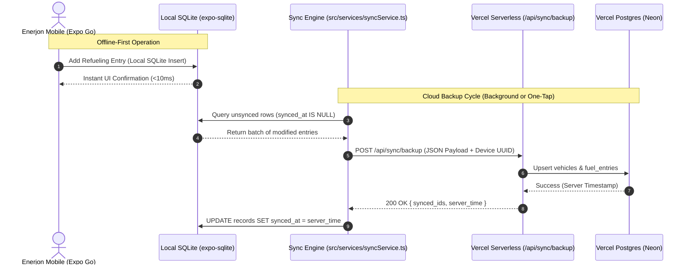
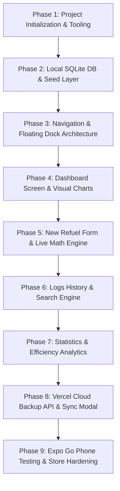

# Enerjon - v0.1 Implementation Plan

## 1. Executive Summary & Objective

**Enerjon** is an offline-first, mobile-exclusive utility application designed for smartphone users to monitor and optimize fuel consumption, vehicle mileage, operating costs, and efficiency trends.

### Key Product Principles

- **Offline-First, Zero Latency**: Vehicle owners frequently log fuel stops at underground or remote filling stations where cellular network signals are degraded. The app must execute all read/write actions against a local SQLite database with zero perceived latency.
- **Vercel Cloud Backup**: Automatic and on-demand synchronization to Vercel Serverless / Cloud Postgres ensures user records are preserved, restorable, and safe against phone loss or device transfer.
- **Expo Go Testability**: The entire codebase is strictly engineered to run inside **Expo Go** on physical Android and iOS phones during active development and dogfooding.
- **Phone-Centric Design**: Meticulously sculpted for mobile ergonomics, one-hand refuel logging, dark-mode night driving aesthetics, and responsive layout accommodating dynamic islands, notches, and navigation bars.
- **Future App Store & Play Store Distribution**: Built on Expo Router and EAS (Expo Application Services) standards to ensure clean compilation into production `.aab` (Google Play) and `.ipa` (Apple App Store) binaries.
- **Brand Identity**: The product name is **Enerjon** (superseding the working title "Fuel Prism" present in legacy Figma renders).

---

## 2. Technology Stack & Language Recommendations

### A. Core Architecture Recommendations Matrix

| Layer | Recommended Choice | Primary Alternatives Considered | Why This Is Optimal |
| :--- | :--- | :--- | :--- |
| **Mobile App Language** | **TypeScript (React Native)** | Dart (Flutter), Swift/Kotlin (Native), Plain JavaScript | • Direct execution in **Expo Go** on physical mobile devices without local macOS/Android Studio compilation.<br>• Single cross-platform codebase compiling to both iOS App Store and Google Play Store via EAS.<br>• Strict end-to-end type safety shared across client database and backend sync APIs.<br>• *(Dart/Flutter cannot run in Expo Go; native Swift/Kotlin requires two separate codebases and a Mac for iOS).* |
| **Mobile Framework** | **Expo SDK 52+ & Expo Router v4** | Bare React Native, Flutter, Capacitor/Cordova | • Modern file-based routing matching web-like ergonomics.<br>• Guaranteed prebuilt native modules bundled directly inside the Expo Go client app.<br>• Cloud builds via EAS without managing complex local Gradle / CocoaPods toolchains. |
| **Local Database Engine** | **`expo-sqlite` (Modern JSI)** | WatermelonDB, Realm, MMKV, AsyncStorage | • 100% compatible with Expo Go out of the box.<br>• Full SQLite ACID compliance with fast native query execution over JSI.<br>• Robust support for relational aggregations (6-month averages, station comparisons, efficiency trends).<br>• *(Realm and WatermelonDB require custom native compilation incompatible with standard Expo Go).* |
| **Styling & Design System** | **NativeWind (v4) / Tailwind CSS** | StyleSheet.create, Tamagui, Styled Components | • Utility-first styling with immediate compilation into native styles.<br>• Seamless implementation of Enerjon's deep obsidian theme (`#0B131B`), translucent borders, and glowing cyan accents.<br>• Zero runtime overhead for style calculations. |
| **Vector Graphics & Charts** | **`react-native-svg`** | Victory Native, Chart.js (WebView), Skia | • Standard module included in Expo Go.<br>• Enables custom lightweight, high-performance SVG Bézier curves, glowing bar charts, and radial donut gauges matching Figma mocks pixel-for-pixel.<br>• *(Skia requires custom native builds not supported in standard Expo Go).* |
| **Backend & Backup Service** | **TypeScript on Vercel Serverless** | Python (FastAPI), Go, Firebase Cloud Functions | • Code reuse: TypeScript interfaces and DTOs shared between mobile client and Vercel endpoints.<br>• Zero server maintenance, instant global Edge/Serverless execution, generous free tier.<br>• Native integration with Vercel Postgres (Neon) or Vercel Blob storage. |
| **Cloud Database** | **Vercel Postgres (Neon Serverless)** | Supabase, Firebase Firestore, DynamoDB | • Serverless PostgreSQL with connection pooling via `@vercel/postgres`.<br>• Relational structure mirrors local SQLite schema, simplifying bidirectional JSON/SQL sync.<br>• One-click provisioning in Vercel project dashboard. |

### B. Why TypeScript + React Native (Expo) is the Most Optimal Language

1. **Unrivaled Expo Go Integration**:
   The user explicitly requested testing via Expo Go on physical phones. Expo Go only runs React Native JavaScript/TypeScript bundles. Developing in Dart/Flutter, Swift, or Kotlin would completely disqualify Expo Go testing and require running heavy local emulator stacks or tethered Xcode/Android Studio debuggers.
2. **Shared Data Contracts**:
   The domain models (`Vehicle`, `FuelEntry`, `SyncPayload`, `EfficiencyStats`) are defined once in TypeScript and consumed by both:
   - The mobile client (for SQLite prepared statements and React UI state).
   - The Vercel serverless functions (for validating incoming sync payloads and executing PostgreSQL upserts).
3. **Compile-Time Safety for Mechanical Calculations**:
   Fuel efficiency involves floating-point arithmetic (odometer deltas, unit conversions between liters and gallons, pricing). TypeScript eliminates runtime typing bugs (such as `null` odometer readings or string-concatenated math) before code reaches the device.

---

## 3. UI/UX Specifications (Faithful to Figma Renders)

### A. Design Tokens & Palette

| Token Name | Hex / Value | Purpose & Usage in Enerjon |
| :--- | :--- | :--- |
| **Deep Obsidian** | `#0B131B` | App background, primary screen scaffold, status bar background |
| **Card Surface** | `#131F2A` | Elevated containers, stat cards, input field containers |
| **Surface Translucent** | `rgba(19, 31, 42, 0.85)` | Floating bottom dock background with backdrop blur |
| **Border Subtle** | `rgba(255, 255, 255, 0.06)` | Clean structural card dividers and input outlines |
| **Electric Cyan** | `#00C2FF` | Primary brand accent, glowing FAB, active tab indicators, chart highlights |
| **Electric Cyan Glow** | `rgba(0, 194, 255, 0.25)` | Shadow drop and outer glow on active metrics and primary CTAs |
| **Cobalt Accent** | `#0A84FF` | Secondary charts, progress bar fill tracks |
| **Text Primary** | `#FFFFFF` | Primary headers, prominent numeric values, high-contrast labels |
| **Text Secondary** | `#94A3B8` | Subheadings, input labels, card meta descriptions |
| **Text Muted** | `#64748B` | Inactive tab labels, chart axis labels, footnote hints |
| **Success / Trend** | `#34D399` | Positive efficiency badges (`+12% vs last month`) |

---

### B. Screen-by-Screen Visual Architecture

#### 1. Global Navigation & Floating Dock (`app/(tabs)/_layout.tsx`)

- **Top Header (`AppHeader.tsx`)**:
  - Left: Enerjon brand icon (cyan gauge/speedometer) + bold "Enerjon" wordmark.
  - Right action cluster:
    - Vercel Sync status icon (cloud/wallet indicator that opens backup modal).
    - Notification bell with unread indicator dot.
    - User avatar badge.
- **Bottom Floating Dock**:
  - Elevated floating pill dock positioned `20px` above the bottom safe area.
  - Four distinct tabs:
    1. **DASH**: Grid icon (`app/(tabs)/index.tsx`)
    2. **REFUEL**: Gas pump icon (`app/(tabs)/new-entry.tsx`)
    3. **LOGS**: Clock/history icon (`app/(tabs)/history.tsx`)
    4. **STATS**: Sparkline/chart icon (`app/(tabs)/statistics.tsx`)
  - Active Tab State: Encased in a soft cyan pill highlight (`rgba(0, 194, 255, 0.12)`) with bright `#00C2FF` icon and text.
- **Floating Action Button (FAB)**:
  - Persistent glowing circular button (`#00C2FF`) with `+` icon positioned floating above the dock on the right of Dashboard and Logs screens.
  - Tapping navigates immediately to the `REFUEL` screen with haptic feedback.

---

#### 2. Screen 1: Dashboard (`Updated Dashboard.png` -> `app/(tabs)/index.tsx`)

1. **Efficiency Index Card**:
   - Hero metric: `18.2 km/L` (default Indian unit: kilometers per liter) in bold display typography.
   - Trend pill: `+12% vs last month` with an upward sparkline icon in green/cyan.
   - Custom SVG Bar Chart: 7 vertical bars with rounded tops representing recent performance cycles. The current active bar is highlighted in glowing Electric Cyan (`#00C2FF`), while past bars are subdued in dark slate (`#1E2C3A`).
2. **Monthly Spend Card**:
   - Primary metric: Currency symbol + `12,450.00` (Indian Rupees `₹` default).
   - Subtitle: `Across 4 refueling stops`.
   - Micro-stats row:
     - `Avg Price/L`: `₹102.50`
     - Custom horizontal dual-color progress track.
     - `Fuel Vol`: `121.5 Liters`.
3. **Fuel Price Trends Card**:
   - Title: `Fuel Price Trends` with subtitle `3-month market fluctuation analysis`.
   - Timeframe segmented control: `Weekly` vs `Monthly` pills (`Monthly` active).
   - Custom SVG Smooth Bézier Wave Chart: High-resolution curved spline with a cyan stroke and a subtle vertical gradient fading into the dark card surface. X-axis labels: `AUGUST`, `SEPTEMBER`, `OCTOBER`.
4. **Recent Log Entries Section**:
   - Section header with history icon: `Recent Log Entries`.
   - List of recent refuel cards:
     - Station name (e.g. `IndianOil - MG Road`, `Shell Select Highway 48`).
     - Yield pill (e.g. `18.4 km/L YIELD`, `17.8 km/L YIELD`).
     - Metadata line: `24 Oct • 35.0 L • ₹3,587.50`.

---

#### 3. Screen 2: New Refueling Entry (`New Entry.png` -> `app/(tabs)/new-entry.tsx`)

1. **Header & Context**:
   - Title: `New Refueling`.
   - Subtitle: `Log your latest trip to the station to track your vehicle's efficiency.`
2. **Form Card Structure**:
   - **Select Vehicle**: Dropdown picker defaulting to the primary vehicle (e.g. `Tata Nexon - Dark Edition` or `Hyundai Creta / Swift`) with down-chevron.
   - **Refuel Date**: Formatted date display (`27/10/2026`) with calendar picker modal trigger.
   - **Total Cost**: Large hero input with prominent Electric Cyan Indian Rupee symbol (`₹`). Large numerical keypad.
   - **Price per Liter**: Input field with gas pump icon and prefilled or user-entered price (e.g. `₹102.50`).
   - **Odometer Reading (km)**: Speedometer icon with formatted distance input (e.g. `42,500 km`).
   - **Live Reactive Calculation Banner**:
     - Dark translucent cyan banner with info circle icon.
     - Dynamically computes and displays: `Estimated fuel volume: 39.02 Liters` as the user types `Total Cost` and `Price per Liter`.
   - **Save Button**:
     - Full-width glowing Electric Cyan pill button with disk/save icon: `Save Entry`.
     - Triggers SQLite insert, recalculates efficiency, fires haptic feedback, and redirects to Dashboard or Logs.
3. **Bottom Quick Stats Row**:
   - **Last Refuel Card**: `12 days ago`, `₹3,200 total`.
   - **Avg Price Card**: `₹101.80/L`, `Down 1.5% MoM`.

---

#### 4. Screen 3: History & Logs (`History.png` -> `app/(tabs)/history.tsx`)

1. **Header & Search**:
   - Title: `Logs`.
   - Subtitle: `Tracking your vehicle energy consumption.`
   - Search & Filter bar:
     - Search input field with search icon: `Search events...` (filters by gas station name or notes).
     - Filter button with sliders icon to filter by date range or vehicle.
2. **Chronological Log Cards**:
   - Formatted Date (e.g. `OCT 24, 2026`).
   - Gas Station Name (e.g. `IndianOil Express`, `BPCL SmartFleet`, `HPCL AutoCare`, `Shell V-Power`).
   - Large highlighted Total Cost on the right (e.g. `₹3,850 TOTAL COST`).
   - Bottom metrics chips:
     - Volume chip with gas pump icon: `VOLUME 37.56 L`.
     - Odometer chip with speedometer icon: `ODOMETER 42,851 km`.
3. **Interaction**:
   - Pull-to-refresh.
   - Tap entry to view/edit details.
   - Swipe to delete with confirmation.

---

#### 5. Screen 4: Statistics & Analytics (`Statistics.png` -> `app/(tabs)/statistics.tsx`)

1. **Performance Overview Header**:
   - Super-title: `PERFORMANCE OVERVIEW`.
   - Dual-tone gradient title: `Efficiency Trends` ("Efficiency" in white, "Trends" in glowing cyan).
   - Top KPI badges:
     - `+14% EFFICIENCY`
     - `2.4k KM RUN`
2. **Monthly Fuel Spending Card**:
   - Header with `Last 6 Months` filter pill.
   - Subtitle: `Comparison of last 6 months against budget`.
   - 6-month SVG bar chart (e.g. `MAY`, `JUN`, `JUL`, `AUG`, `SEP`, `OCT`), highlighting the latest month in glowing cyan.
3. **Average Monthly Cost Card**:
   - Hero metric: `₹ 12,480.00`.
   - Sparkline badge: `-4.2% from last month`.
4. **Total Mileage Card**:
   - Hero metric: `18,840 km`.
   - Status badge: `✓ On track for annual goal`.
5. **Price per Station Card**:
   - Radial donut gauge chart displaying central average price: `AVG PRICE ₹102.40`.
   - Color-coded station price breakdown list:
     - Light Cyan dot: `Shell India` -> `₹104.50`
     - Cyan dot: `IndianOil` -> `₹102.20`
     - Slate Blue dot: `BPCL` -> `₹102.10`
6. **Efficiency Recommendation Card**:
   - Actionable Indian driving condition tip: `"Based on your recent highway logs, shifting your cruising speed from 100km/h down to 85km/h could save an estimated ₹1,200 per month."`
   - Metric pills:
     - Leaf icon: `CURRENT ECO SCORE: 82/100`
     - Bolt icon: `POTENTIAL SAVING: 12%`
   - Button: `View Detailed Log History` (navigates to Logs tab).

---

#### 6. Cloud Backup & Sync Modal (`app/modal.tsx`)

- Triggered via the cloud icon in `AppHeader`.
- Displays:
  - Local Database Status: Total entries stored, database size in KB, pending unsynced records.
  - Vercel Sync Status: Last successful cloud backup timestamp.
  - Action Controls:
    - `Backup to Vercel Now` (initiates manual push).
    - `Restore from Cloud Backup` (retrieves and rehydrates SQLite).
    - `Export Data as JSON` (shareable backup file via React Native Share API).
    - Vercel Backend URL configuration field.

---

## 4. Local Database Architecture (`expo-sqlite`)

### A. SQLite Schema DDL (`src/db/schema.ts`)

```sql
-- 1. Vehicles Table
CREATE TABLE IF NOT EXISTS vehicles (
  id TEXT PRIMARY KEY NOT NULL,
  name TEXT NOT NULL,
  license_plate TEXT,
  fuel_type TEXT NOT NULL DEFAULT 'petrol', -- 'petrol' | 'diesel' | 'cng' | 'hybrid' | 'electric'
  fuel_unit TEXT NOT NULL DEFAULT 'liters', -- Default Indian unit: 'liters' | 'gal'
  distance_unit TEXT NOT NULL DEFAULT 'km', -- Default Indian unit: 'km' | 'mi'
  currency_symbol TEXT NOT NULL DEFAULT '₹',-- Default Indian unit: '₹' | '$' | '€' | '£'
  is_primary INTEGER NOT NULL DEFAULT 1,
  created_at TEXT NOT NULL,
  updated_at TEXT NOT NULL,
  synced_at TEXT
);

-- 2. Fuel Refuel Entries Table
CREATE TABLE IF NOT EXISTS fuel_entries (
  id TEXT PRIMARY KEY NOT NULL,
  vehicle_id TEXT NOT NULL REFERENCES vehicles(id) ON DELETE CASCADE,
  date TEXT NOT NULL,
  odometer REAL NOT NULL,
  fuel_amount REAL NOT NULL,
  price_per_unit REAL NOT NULL,
  total_cost REAL NOT NULL,
  is_full_tank INTEGER NOT NULL DEFAULT 1,
  gas_station TEXT NOT NULL,
  notes TEXT,
  calculated_efficiency REAL, -- MPG or km/L calculated from previous full tank
  created_at TEXT NOT NULL,
  updated_at TEXT NOT NULL,
  synced_at TEXT
);

-- 3. App Settings Table
CREATE TABLE IF NOT EXISTS app_settings (
  key TEXT PRIMARY KEY NOT NULL,
  value TEXT NOT NULL,
  updated_at TEXT NOT NULL
);

-- Indexes for ultra-fast queries in History and Statistics
CREATE INDEX IF NOT EXISTS idx_fuel_entries_vehicle ON fuel_entries(vehicle_id);
CREATE INDEX IF NOT EXISTS idx_fuel_entries_date ON fuel_entries(date DESC);
CREATE INDEX IF NOT EXISTS idx_fuel_entries_sync ON fuel_entries(synced_at);
```

### B. Fuel Efficiency Calculation Engine (`src/services/calculations.ts`)

Fuel efficiency is calculated strictly using the **Full Tank to Full Tank standard methodology**:

1. When a user fills their tank completely (`is_full_tank = 1`):
   $$\text{Distance Delta} = \text{Odometer}_{\text{current}} - \text{Odometer}_{\text{last full}}$$
   $$\text{Fuel Consumed} = \sum \text{Fuel Amount since last full tank}$$
   $$\text{Efficiency (MPG or km/L)} = \frac{\text{Distance Delta}}{\text{Fuel Consumed}}$$
2. If the user performs partial refills between two full refills, the fuel volume from the partial refills is aggregated into the denominator when the subsequent full refill occurs.
3. If unit is `L/100km`:
   $$\text{Efficiency (L/100km)} = \frac{\text{Fuel Consumed} \times 100}{\text{Distance Delta}}$$

---

## 5. Vercel Cloud Backup Architecture



### A. Vercel Endpoint Specification (`api/sync/backup.ts`)

- **Route**: `POST /api/sync/backup`
- **Headers**:
  - `Content-Type: application/json`
  - `x-device-id: <uuid>` (Generated on first launch and preserved in `expo-secure-store` or SQLite `app_settings`)
- **Payload Schema**:

  ```json
  {
    "device_id": "f81d4fae-7dec-11d0-a765-00a0c91e6bf6",
    "timestamp": "2026-10-20T12:00:00Z",
    "vehicles": [
      {
        "id": "v-1",
        "name": "Tata Nexon - Dark Edition",
        "license_plate": "KA-01-EQ-7700",
        "fuel_type": "petrol",
        "fuel_unit": "liters",
        "distance_unit": "km",
        "currency_symbol": "₹",
        "is_primary": 1,
        "updated_at": "2026-10-20T11:00:00Z"
      }
    ],
    "fuel_entries": [
      {
        "id": "f-101",
        "vehicle_id": "v-1",
        "date": "2026-10-20",
        "odometer": 42851.0,
        "fuel_amount": 35.0,
        "price_per_unit": 102.50,
        "total_cost": 3587.50,
        "is_full_tank": 1,
        "gas_station": "IndianOil - MG Road",
        "notes": "Full tank autofill",
        "calculated_efficiency": 18.2,
        "updated_at": "2026-10-20T11:00:00Z"
      }
    ]
  }
  ```

- **Response**:

  ```json
  {
    "success": true,
    "synced_count": 1,
    "server_timestamp": "2026-10-20T12:00:05Z"
  }
  ```

### B. Vercel Endpoint Specification (`api/sync/restore.ts`)

- **Route**: `GET /api/sync/restore?device_id=<uuid>`
- **Response**: Complete snapshot of all records associated with that device/user to populate a blank device upon reinstallation.

---

## 6. Expo Go Compatibility & Mobile-Only Safeguards

### A. Library Audit for Strict Expo Go Support

To ensure zero build failures when opening the project via the Expo Go QR code on iOS and Android phones, only approved bundled libraries will be used:

| Library | Supported in Expo Go? | Purpose in Enerjon |
| :--- | :---: | :--- |
| `expo-router` | ✅ Yes | File-based tabs and modal navigation |
| `expo-sqlite` | ✅ Yes | Local client database |
| `react-native-svg` | ✅ Yes | Custom charts, trend lines, donut gauges |
| `@expo/vector-icons` | ✅ Yes | Tab icons, gas pump, speedometer, settings |
| `expo-haptics` | ✅ Yes | Tactile feedback on save button and tab switches |
| `expo-constants` | ✅ Yes | Device ID generation & app versioning |
| `nativewind` | ✅ Yes | Tailwind CSS utility classes |
| `react-native-safe-area-context` | ✅ Yes | Notch, dynamic island, and home bar insets |

> [!IMPORTANT]
> **Strict Expo Go Rule**: Never install packages that require custom native C++/Java/Objective-C code or custom Android `build.gradle` alterations (e.g. `react-native-firebase`, `@shopify/react-native-skia`, `realm`, or `react-native-sqlite-storage`). Sticking to Expo SDK managed packages ensures 100% immediate compatibility with Expo Go.

### B. Mobile-Only Ergonomics

1. **Locked Orientation**: Hardcoded to `portrait` in `app.json` to prevent disruptive screen rotation during gas station entry.
2. **Dynamic Insets**: All screens wrapped in `SafeAreaView` with top and bottom paddings respecting device status bars and iOS home indicators.
3. **Keyboard Handling**: Form on `New Entry` screen leverages `KeyboardAvoidingView` with `behavior={Platform.OS === 'ios' ? 'padding' : 'height'}` so inputs are never obstructed by the numeric keypad.

---

## 7. Future Store Deployment Roadmap (Google Play & Apple App Store)

When moving from testing in Expo Go to production store deployment, Enerjon will utilize **EAS (Expo Application Services)**:

1. **Configuration (`app.json` & `eas.json`)**:
   - `android.package`: `com.enerjon.app`
   - `ios.bundleIdentifier`: `com.enerjon.app`
   - Orientation: `portrait`
   - Android Permissions: Minimal (`INTERNET` for Vercel backup, zero sensitive location or SMS permissions required).
2. **Store Assets**:
   - High-resolution App Icon (`1024x1024` PNG) featuring Enerjon's electric cyan gauge emblem on deep obsidian.
   - Adaptive Android icons (`foregroundImage` and `backgroundColor: "#0B131B"`).
   - Splash screen with seamless `#0B131B` background color matching native launch.
3. **Automated EAS Cloud Builds**:
   - `eas build --platform android --profile production` -> outputs signed `.aab` for Google Play Console.
   - `eas build --platform ios --profile production` -> outputs signed `.ipa` for TestFlight and Apple App Store.

---

## 8. Step-by-Step Implementation Roadmap



### Detailed Phase Breakdown

- [x] **Phase 1: Project Initialization & Tooling**
  - Initialized clean Expo SDK 57 project (strictly aligned with Google Play Store Expo Go v57.0.9) with TypeScript.
  - Installed all 9 dependencies verified for Expo Go (`expo-router`, `expo-sqlite`, `react-native-safe-area-context`, `react-native-screens`, `expo-status-bar`, `react-native-svg`, `@expo/vector-icons`, `expo-haptics`, `expo-constants`, `expo-linking`).
  - Configured `app.json` with app name `"Enerjon"`, slug `"enerjon"`, portrait orientation, and dark theme (`#0B131B`).
  - Set up `tsconfig.json`, `metro.config.js`, `.gitignore`, and design system tokens in `src/constants/theme.ts`.
  - Implemented unit conversion and Indian numbering formatting engine (`₹`, `liters`, `km`, `km/L`) in `src/constants/units.ts`.

- [x] **Phase 2: Local Database Layer (`expo-sqlite`)**
  - Implemented `src/db/schema.ts` with tables (`vehicles`, `fuel_entries`, `app_settings`) using Indian defaults.
  - Implemented `src/db/client.ts` with `expo-sqlite` asynchronous prepared queries, migrations, and CRUD operations.
  - Seeded initial realistic Indian vehicle (`Tata Nexon - Dark Edition`) and refueling logs (`IndianOil`, `BPCL`, `HPCL`, `Shell India`).
  - Implemented fuel efficiency calculation engine in `src/services/calculations.ts` (full-tank delta in km/L, 6-month spend history, station price comparison).

- [x] **Phase 3: Navigation & Global Layout**
  - Implemented root `app/_layout.tsx` with `SafeAreaProvider`, dark status bar, and database auto-initialization.
  - Built custom floating bottom dock in `app/(tabs)/_layout.tsx` (`DASH`, `REFUEL`, `LOGS`, `STATS`) with cyan pill active highlights.
  - Implemented top `src/components/AppHeader.tsx` with Enerjon branding, unread notification dot, cloud backup trigger, and avatar.
  - Implemented floating action button `src/components/FloatingAddButton.tsx` with electric cyan glow and haptic feedback.

- [x] **Phase 4: Dashboard Screen (`app/(tabs)/index.tsx`)**
  - Efficiency Index Card: `18.2 km/L` display, `+12% vs last month` pill, and 7-bar SVG chart with active cyan highlight.
  - Monthly Spend Card: `₹12,450.00`, stop count, average price per liter, and dual-tone progress bar.
  - Fuel Price Trends Card: Weekly/Monthly toggle with smooth Bézier SVG area chart.
  - Recent Log Entries list with station cards and yield tags.

- [x] **Phase 5: New Refueling Screen (`app/(tabs)/new-entry.tsx`)**
  - Vehicle dropdown selector (`Tata Nexon - Dark Edition`).
  - Date picker with calendar icon.
  - Large currency input for Total Cost with Electric Cyan `₹` prefix.
  - Price per Liter (`₹/L`) and Odometer (`km`) inputs.
  - Reactive live calculation banner for estimated fuel volume in Liters.
  - Full-width glowing `Save Entry` button connected to SQLite insert with haptics.
  - Quick comparison cards: `Last Refuel` and `Avg Price`.

- [x] **Phase 6: Logs History Screen (`app/(tabs)/history.tsx`)**
  - Search bar filtering by gas station name, notes, or date.
  - Filter button trigger.
  - Chronological card list with date, station, cost badge (`₹`), volume chip (`L`), and odometer chip (`km`).
  - Long-press to delete entry with confirmation dialog.

- [x] **Phase 7: Statistics Screen (`app/(tabs)/statistics.tsx`)**
  - Performance overview header with dual-tone title and KPI badges (`+14% EFFICIENCY`, `2.4k KM RUN`).
  - 6-month spending SVG bar chart (`MAY` through `OCT`).
  - Average monthly cost (`₹ 12,480.00`) and total mileage (`18,840 km`) goal cards.
  - Price per Station Donut/Radial gauge with central average `₹102.40` and color-coded station legend.
  - Eco Score recommendation card with actionable speed optimization tip and CTA button.

- [x] **Phase 8: Vercel Backup Serverless API & Sync Modal**
  - Created `api/sync/backup.ts` serverless handler to receive JSON payload.
  - Created `api/sync/restore.ts` serverless handler.
  - Implemented `src/services/syncService.ts` for push/pull sync logic.
  - Implemented `app/modal.tsx` with backup trigger, database inspection, and offline resilience banner.

- [ ] **Phase 9: Expo Go Phone Testing & Store Preparation**
  - Test on physical Android and iOS phones via Expo Go (`npx expo start`).
  - Test offline resilience in Airplane Mode.
  - Configure `eas.json` for future automated cloud compilation for Google Play Store and Apple App Store.

- [ ] **Phase 8: Vercel Backup Serverless API & Sync Modal**
  - Create `api/sync/backup.ts` serverless handler to receive JSON payload.
  - Create `api/sync/restore.ts` serverless handler to return device snapshot.
  - Implement `src/services/syncService.ts` for push/pull sync logic.
  - Implement `app/modal.tsx` with backup trigger, database inspection, and JSON export.

- [ ] **Phase 9: Expo Go Phone Testing & Store Preparation**
  - Verify app runs without warnings in Expo Go on physical iOS and Android devices.
  - Test offline resilience by placing phone in Airplane Mode and logging entries.
  - Test cloud backup restoration.
  - Configure `eas.json` for future automated cloud compilation for Google Play Store and Apple App Store.
